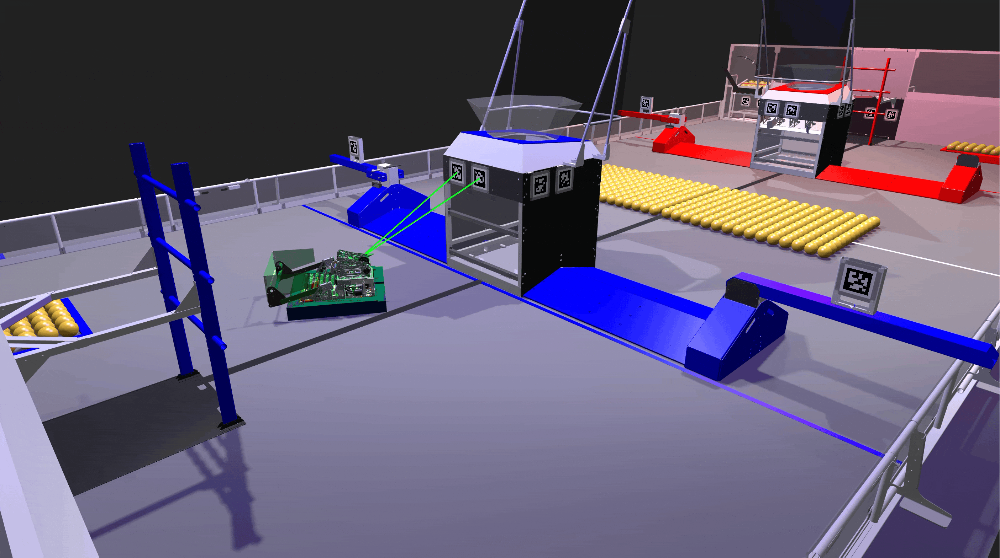

# FRC Robot Localization Simulator

An example of using [YALL](https://yall.yassrobotics.com/) to simulate a Limelight camera in WPILib 2026 desktop simulation, and visualize the robot's localization and the camera-to-AprilTag rays in AdvantageScope.

<!--
  Save a short screen recording as docs/demo.gif, then delete the "coming soon" line below
  and remove the comment markers around the image line.
-->

## Run the simulation

1. Open this folder in **WPILib VS Code 2026**.
2. Run **WPILib: Simulate Robot Code** and choose **Sim GUI**. You can also run `./gradlew simulateJava`.
3. In the Sim GUI, set the robot to **Teleoperated** and drive around.

## Visualize in AdvantageScope

1. Open **AdvantageScope** (the copy that comes with WPILib 2026).
2. Click **File → Connect to Simulator**.
3. Add a **3D Field** tab and set the field to **2026 Field**.
4. Drag these topics from the sidebar into the tab's sources:

| Topic | Object type | Shows |
|---|---|---|
| `/Localization/GroundTruthPose` | Robot | Where the robot really is |
| `/Vision/CameraRays` | Trajectory | Rays from the camera to the center of each visible AprilTag |
| `/Localization/FusedPose` | Ghost | Odometry + vision estimate |
| `/Localization/OdometryPose` | Ghost (another color) | Odometry-only estimate, never corrected by vision |

The rays appear when a tag is in view and disappear when it leaves the camera's view.

> Use the topics under `/Localization` and `/Vision`, not `/SmartDashboard/Localization Field`. The Field2d entries under `/SmartDashboard` are 2D only, so on the 3D field they draw flat on the floor or in the wrong place.

**Shortcut:** **File → Import Layout…** with `advantagescope/LocalizationLayout.json` sets up these tabs for you.

---

This project was generated using [Claude Code](https://claude.com/claude-code).
